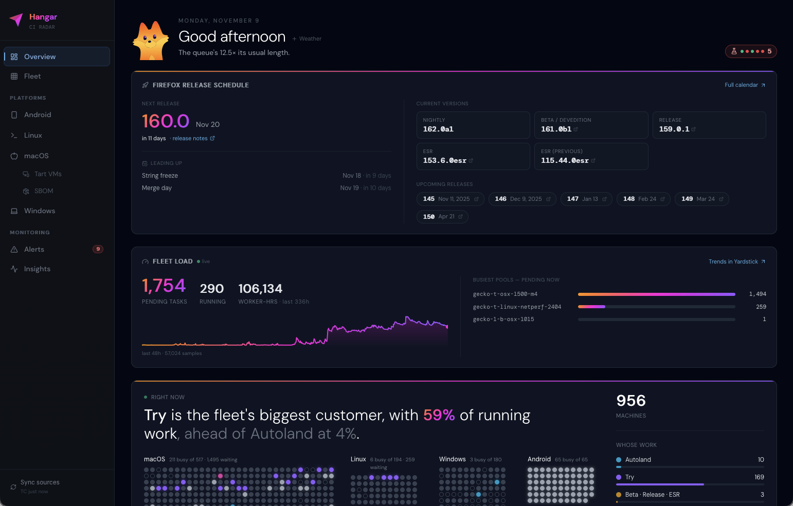

## A first look



*The overview dashboard.*

```sh
{{launch}}
```

*Opens the hosted dashboard in your browser. Sign in with your Mozilla account;
no local Python environment or Taskcluster token is needed.*

Start with the overview, then choose a platform or Fleet to inspect machines.
Use Alerts and Insights to investigate conditions that need attention.
