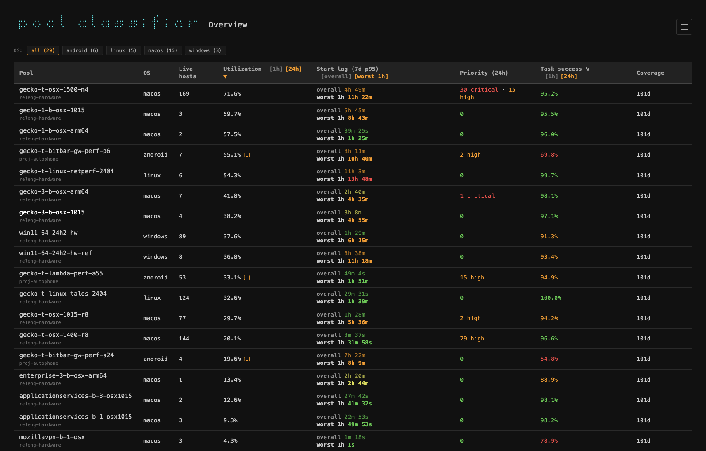

## When to use it

Start here when a worker pool's success rate changes and you want to see which
workers or failures account for it. The dashboard groups task results using log
patterns, helping you move from a pool-wide symptom to examples worth inspecting.



*Pool health across platforms.*

## A first look

```sh
{{launch}}
```

*Opens the hosted dashboard in your browser. Sign in with your Mozilla account;
you do not need to run the classifier service on your machine.*

Choose a pool, look at its recent success rate and alerting workers, then inspect
the grouped failures. Follow the task links to compare the underlying logs before
deciding whether a pattern points to the worker, the test, or another service.
Unclassified failures are useful starting points for adding or improving patterns.

## Reading the results

Classification is a way to organize evidence. Several tasks matching the same
pattern can help you spot a recurring problem, but the match alone does not
establish its cause. Check the time range and original task logs when comparing
results or following up on a suspected regression.

The [upstream documentation](#tool-requirements) covers the service, its API,
and contributing classification patterns. Those development dependencies are
separate from simply using the hosted dashboard.
