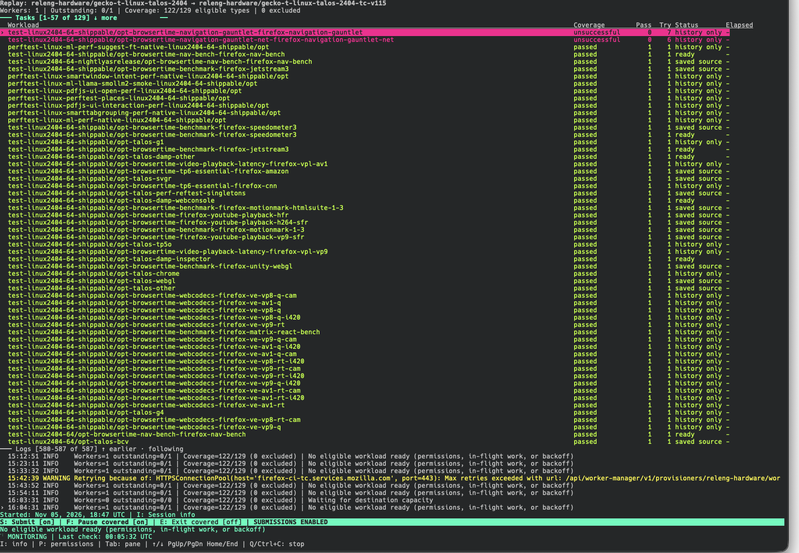

## When to use it

Use pool replay when testing a destination pool against a mix of jobs from an
existing pool—for example, while evaluating a worker configuration change.
Coverage tracks which discovered workload types have completed successfully in
the replay session, rather than treating one successful task as a full test.



*An active session with submissions enabled.*

## Read the setup first

```sh
{{launch}} -h
```

*Shows the pool, session, and credential options. Active monitoring needs a
Taskcluster token even when you select `--dry-run`; help itself does not.*

Follow the [requirements and scope instructions](#tool-requirements). Submission
permissions depend on both the destination and the selected source workloads.
The dashboard's permissions view shows which workloads are missing scopes.

## Check one cycle without submitting

```sh
{{launch}} --from-pool SOURCE_POOL --queue DESTINATION_POOL --new-session --dry-run --once
```

*Replace both pools with your intended source and destination. This creates a
local session, checks one monitoring cycle, and exits without submitting tasks.*

For ongoing monitoring, omit `--once`. A new monitoring session starts with
submissions paused; enable them explicitly in the dashboard or with
`--submit-on-start`. Use a separate destination pool suitable for the source
payloads. Only level-1 sources are accepted.

## Return to a saved session

```sh
{{launch}} --session /absolute/path/to/session
```

*Use the session path printed by the tool. Viewing the saved report makes no
Taskcluster calls; add `--resume` when you intend to monitor again.*

The launcher still fetches the source unless you also select its `--offline`
option before the tool name, using an already prepared cache. Session reports
live outside the launcher's temporary checkout and survive its cleanup.
